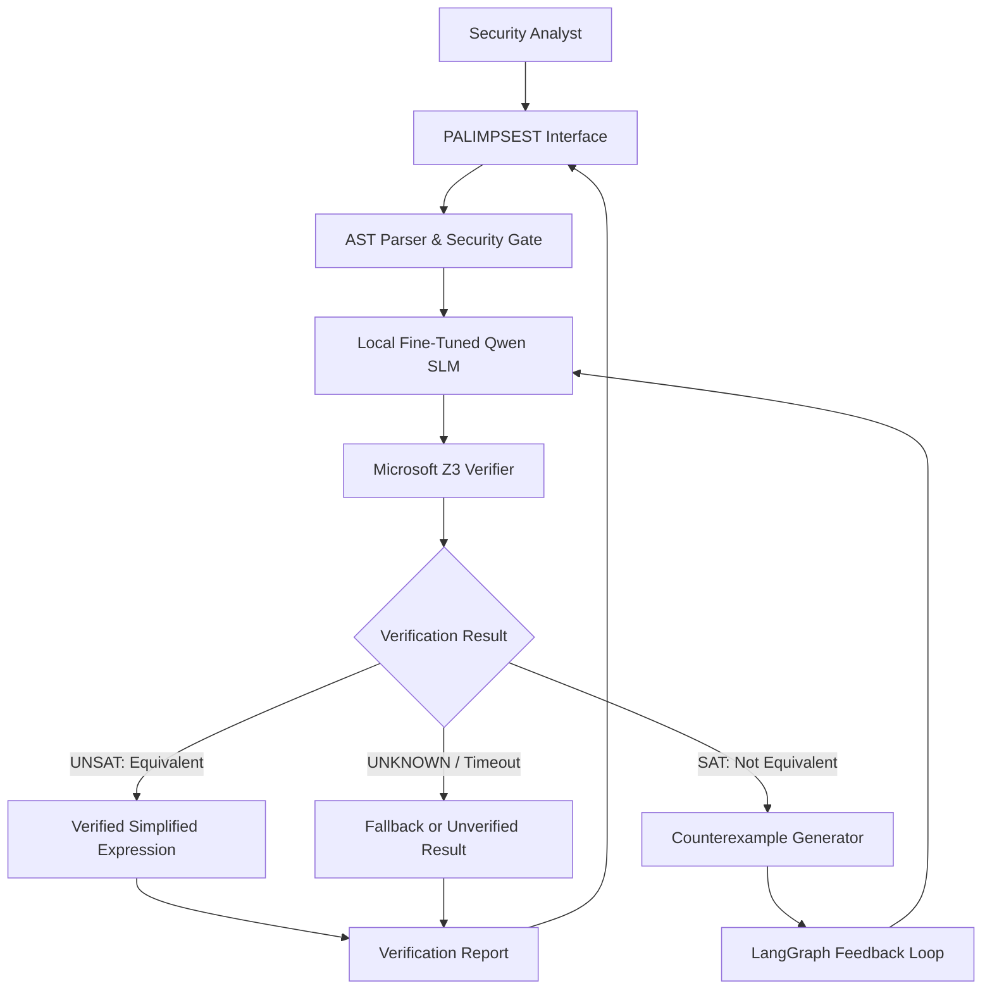
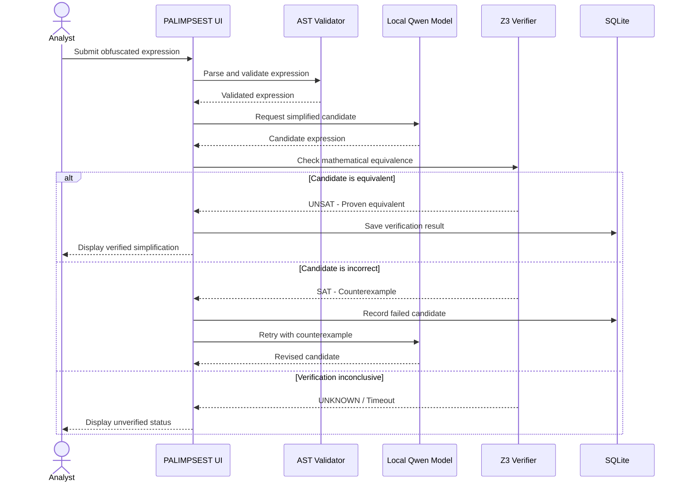
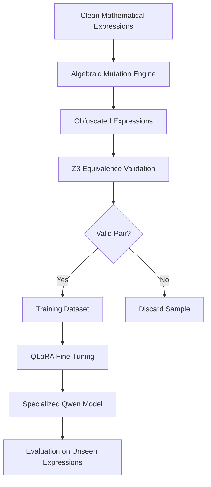

# 🛡️ PALIMPSEST
### Autonomous Neurosymbolic De-obfuscation

**The AI Proposes. The Mathematics Proves.**

An offline-first, AI-powered code de-obfuscation system that combines the pattern-recognition capabilities of a fine-tuned Small Language Model (SLM) with the mathematical certainty of formal verification.

**Hackathon:** DEXATHON 2026  
**Domain:** AI/ML · Smart Automation · Cybersecurity  
**Category:** Software Development  
**Team:** Nexus 6.0  
**Team ID:** DEX26348  
**Project Status:** Prototype Development

---

## 📌 Table of Contents

1. [Project Overview](#-project-overview)
2. [Problem Statement](#-problem-statement)
3. [Our Solution](#-our-solution)
4. [Core Innovation](#-core-innovation)
5. [System Architecture](#-system-architecture)
6. [User Workflow](#-user-workflow)
7. [How PALIMPSEST Works](#-how-palimpsest-works)
8. [AI/ML Training Pipeline](#-aiml-training-pipeline)
9. [Formal Mathematical Verification](#-formal-mathematical-verification)
10. [Technology Stack](#-technology-stack)
11. [Features](#-features)
12. [Repository Structure](#-repository-structure)
13. [Getting Started](#-getting-started)
14. [Evaluation and Benchmarks](#-evaluation-and-benchmarks)
15. [Safety and Limitations](#-safety-and-limitations)
16. [Real-World Applications](#-real-world-applications)
17. [Future Scope](#-future-scope)
18. [Research and References](#-research-and-references)
19. [Team](#-team)

---

## 🔍 Project Overview

Modern software security analysis faces a critical challenge: malicious and protected programs often contain deliberately complicated code that conceals their actual behavior.

This process, known as **code obfuscation**, transforms relatively simple operations into confusing mathematical expressions and execution structures.

Traditional reverse-engineering tools provide powerful analysis capabilities, but advanced obfuscation can still require substantial manual investigation.

AI models can suggest simpler interpretations, but their outputs are not guaranteed to preserve the original program's behavior.

**PALIMPSEST bridges this gap using neurosymbolic AI.**

It combines two complementary technologies:

- **Neural Intelligence:** A locally deployed, specialized language model proposes simplified code expressions.
- **Symbolic Intelligence:** Microsoft Z3 mathematically verifies whether those expressions preserve the original behavior.

When a proposal is incorrect, the system extracts a counterexample and provides it to the AI for another attempt.

The result is a controlled, explainable workflow in which AI-generated transformations are never accepted without verification.

> **Our vision:** Make complex code analysis more accessible, verifiable, and privacy-preserving through specialized AI and formal mathematics.

---

## 🚨 Problem Statement

### The Malware Obfuscation Challenge

Security analysts frequently encounter software containing deliberately obfuscated instructions.

Techniques such as **Mixed Boolean-Arithmetic (MBA)**, **opaque predicates**, and **control-flow flattening** can make relatively simple logic difficult to interpret.

Three major challenges arise:

| Existing Approach | Limitation |
|---|---|
| Traditional decompilers | Complex obfuscation may require extensive manual analysis or additional simplification techniques |
| Standalone generative AI | May suggest plausible but mathematically incorrect transformations |
| Cloud-based AI tools | May be unsuitable for environments where sensitive code cannot leave organizational infrastructure |

### Why Does This Matter?

A security analyst investigating suspicious code must understand what that code actually does.

If an AI system incorrectly simplifies a calculation, the resulting interpretation may be misleading.

For example, changing a bitwise expression incorrectly could alter how an analyst understands a program's logic.

**The central challenge is not simply generating readable code. It is generating readable code while proving that its behavior remains unchanged.**

---

## 💡 Our Solution

### PALIMPSEST: Autonomous Neurosymbolic De-obfuscation

PALIMPSEST is designed to simplify supported obfuscated expressions using a closed-loop combination of AI and mathematical verification.

The system follows five core stages:

**1. Analyze:** Parse the supplied expression and construct an Abstract Syntax Tree (AST).

**2. Propose:** A specialized local AI model predicts a simpler equivalent expression.

**3. Verify:** Microsoft Z3 checks whether the original and proposed expressions are equivalent.

**4. Self-Correct:** If verification fails, a mathematical counterexample is returned to the AI for another attempt.

**5. Deliver:** A successfully verified simplification is presented with its verification status and complexity measurements.

If verification cannot be completed, the system reports that the result is unverified instead of claiming correctness.

---

## ✨ Core Innovation

### Why PALIMPSEST Is Different

PALIMPSEST is not simply an LLM that rewrites code.

Its design focuses on four technical principles.

**1. Neurosymbolic Reasoning**

AI performs the difficult search for simpler expressions, while a mathematical solver independently checks correctness.

**2. Counterexample-Guided Self-Correction**

When a proposed expression is incorrect, the solver provides an exact input where the two expressions behave differently.

The AI receives this feedback and attempts to correct its mistake.

**3. Synthetic Mathematical Training Data**

Rather than manually collecting thousands of labeled malware samples, the project proposes generating training pairs using valid algebraic transformations.

Every generated pair can be checked using a formal solver before entering the dataset.

**4. Privacy-Preserving Local Inference**

The proposed deployment runs the language model and verification tools locally, reducing dependence on external AI APIs and keeping submitted expressions within the controlled environment.

### Our Guiding Principle

**AI is responsible for proposing. Mathematics is responsible for deciding whether the proposal is correct.**

---

## 🏗️ System Architecture

### High-Level Architecture



### Architecture Components

| Component | Technology | Responsibility |
|---|---|---|
| Analyst interface | Streamlit / Python UI | Accept expressions and display results |
| Input security gate | Python AST | Validate supported operations and reject unsafe syntax |
| Neural proposer | Qwen2.5-Coder-3B | Generate candidate simplifications |
| Model specialization | Unsloth + QLoRA | Fine-tune the model on synthetic expression pairs |
| Symbolic verifier | Microsoft Z3 | Check exact bit-vector equivalence |
| Feedback controller | LangGraph | Coordinate iterative correction |
| Tool interface | MCP, optional | Expose restricted verification functions |
| Execution history | SQLite | Record candidates, solver results, and iterations |

### Design Philosophy

The AI model is never treated as the final authority.

**Verification is a mandatory gate before a result can be labeled mathematically equivalent.**

---

## 👨‍💻 User Workflow

### How a Security Analyst Uses PALIMPSEST



### From the User's Perspective

1. Open PALIMPSEST.
2. Paste a supported obfuscated expression.
3. Start the analysis.
4. Observe the AI-generated simplification attempts.
5. View whether mathematical verification succeeds.
6. Inspect the final expression, complexity reduction, and verification history.

For the initial prototype, the user submits mathematical or bitwise expressions rather than arbitrary executable malware.

---

## ⚙️ How PALIMPSEST Works

### A Complete Worked Example

Consider the following expression:

```python
((x ^ y) + 2 * (x & y))
```

At first glance, it appears to combine bitwise and arithmetic operations in a complicated way.

However, this expression is mathematically equivalent to:

```python
x + y
```

PALIMPSEST aims to discover and verify this relationship automatically.

### Step 1: Parse the Expression

The AST parser examines the expression's structure.

It identifies:

- Variables: `x`, `y`
- Operations: XOR, AND, multiplication, addition
- Register width: Configured fixed-width bit-vectors
- Expression complexity: AST size and depth

Only operations belonging to the supported mathematical grammar are accepted.

### Step 2: AI Proposes a Simplification

The fine-tuned model attempts to simplify the expression.

Suppose its first proposal is:

```python
x ^ y
```

This looks reasonable, but it is incorrect because it omits the carry component of addition.

### Step 3: Z3 Checks the Proposal

The verification engine checks whether there exists any input for which the original expression and the AI proposal produce different outputs.

For example:

```text
x = 1
y = 1
```

Original expression:

```text
(1 ^ 1) + 2 * (1 & 1)
= 0 + 2
= 2
```

AI proposal:

```text
1 ^ 1 = 0
```

The outputs differ.

**Verification result: SAT — Counterexample found.**

The AI proposal is rejected.

### Step 4: Counterexample Feedback

The counterexample is sent back to the neural proposer.

```text
Your proposed expression is not equivalent.

Counterexample:
x = 1
y = 1

Original output: 2
Candidate output: 0

Generate a corrected simplification.
```

The model can now revise its proposal using mathematical evidence.

### Step 5: Revised Proposal

The AI proposes:

```python
x + y
```

Z3 checks:

```text
Original != Candidate
```

If the solver returns `UNSAT`, no differing input exists within the defined bit-vector model.

**Verification result: UNSAT — Equivalence established.**

### Final Output

```text
PALIMPSEST ANALYSIS

Original:
((x ^ y) + 2 * (x & y))

Simplified:
x + y

Verification:
PROVEN EQUIVALENT

Method:
Z3 Bit-Vector Equivalence Check

Status:
VERIFIED
```

This example illustrates the central purpose of PALIMPSEST:

**An incorrect AI prediction becomes a mathematically guided correction opportunity.**

---

## 🧠 AI/ML Training Pipeline

### Specialized Decoder-Only Language Model

PALIMPSEST proposes using **Qwen2.5-Coder-3B**, a code-specialized decoder-only Transformer model.

The goal is to adapt this model for a narrow task: recognizing complicated mathematical expressions and proposing simpler equivalent forms.

Rather than training a language model from scratch, the project uses parameter-efficient fine-tuning.

### Phase 1: Synthetic Dataset Generation

The training pipeline begins with simple mathematical expressions.

Example:

```text
Clean expression:
x + y
```

A transformation engine applies mathematically valid rewriting identities.

```text
Obfuscated expression:
(x ^ y) + 2 * (x & y)
```

The resulting pairs are reversed to train the model:

```text
INPUT:
(x ^ y) + 2 * (x & y)

TARGET:
x + y
```

This method allows the team to generate task-specific labeled examples without manually reverse-engineering malware samples.

### Training Data Architecture



### Phase 2: Supervised Fine-Tuning

The proposed training stack uses:

- Qwen2.5-Coder-3B-Instruct
- Hugging Face Transformers
- Unsloth
- PEFT / LoRA / QLoRA
- PyTorch

The model learns the relationship between obfuscated inputs and simpler target expressions.

### Phase 3: Counterexample-Aware Training

The blueprint proposes including failed simplifications and their counterexamples in the training data.

This helps the model learn how to respond to mathematical verification failures, not only how to produce an initial answer.

### Phase 4: Local Deployment

After training, the specialized model can be exported in a suitable quantized format for local inference.

The actual memory requirements, latency, and hardware compatibility must be benchmarked on the target device.

### Model Evaluation

The team should compare:

- Base model performance
- Fine-tuned model performance
- Performance with counterexample feedback
- Performance with formal verification enabled

This will help establish whether the specialized training and feedback loop improve the system.

---

## 📐 Formal Mathematical Verification

### Why Mathematical Proof Is Essential

Testing a program on a few sample inputs does not establish that two expressions are equivalent for every possible input.

PALIMPSEST uses Microsoft Z3 to reason about fixed-width bit-vector operations.

Let:

- `E_original` be the obfuscated expression.
- `E_candidate` be the proposed simplified expression.

The solver checks:

```text
E_original != E_candidate
```

### Possible Verification Outcomes

| Solver Result | Meaning | System Action |
|---|---|---|
| `UNSAT` | No counterexample exists under the encoded semantics | Mark equivalent |
| `SAT` | At least one differing input exists | Reject candidate and return counterexample |
| `UNKNOWN` | The solver cannot establish the result | Report unverified or use a controlled fallback |

### Why 64-Bit Semantics Matter

Computer arithmetic differs from ordinary mathematical arithmetic because fixed-width values wrap around.

For example, unsigned 64-bit addition operates modulo \(2^{64}\).

A simplification that works over ordinary integers may not preserve the behavior of a 64-bit machine expression.

Z3's bit-vector logic enables the system to reason about these fixed-width operations explicitly.

### Formal Verification Boundary

PALIMPSEST's equivalence result applies to the exact expressions, bit widths, and semantics modeled in the solver.

It does not automatically prove that an entire executable, malware sample, or arbitrary program is equivalent.

This distinction is essential to keeping the system trustworthy.

---

## 🛠️ Technology Stack

| Layer | Technology |
|---|---|
| Programming Language | Python |
| Specialized AI Model | Qwen2.5-Coder-3B |
| Model Training | Unsloth, QLoRA, PyTorch |
| Model Ecosystem | Hugging Face Transformers |
| Formal Verification | Microsoft Z3 |
| Agent Orchestration | LangGraph |
| Tool Integration | Model Context Protocol (MCP), planned |
| Expression Parsing | Python AST |
| Database | SQLite |
| Local Inference | Quantized local model runtime |
| User Interface | Streamlit, proposed |
| Development Environment | VS Code / Jupyter / Kaggle GPU |

All technologies listed form part of the proposed architecture. Their implementation status should be updated as development progresses.

---

## 🚀 Features

### Core Prototype Features

| Feature | Description |
|---|---|
| Safe expression input | Accepts expressions within a restricted mathematical grammar |
| AST parsing | Extracts structure, supported operators, and complexity |
| AI-driven simplification | Proposes human-readable alternatives |
| Mathematical verification | Checks bit-vector equivalence using Z3 |
| Counterexample feedback | Explains why an incorrect transformation fails |
| Iterative correction | Retries proposals within a defined limit |
| Verification report | Displays proven, rejected, or unresolved outcomes |
| Local processing | Designed to avoid external inference API calls |

### Planned Advanced Capabilities

- Fine-tuned 3B local language model
- Counterexample-aware training trajectories
- Preference optimization for simpler verified expressions
- AST subtree decomposition
- Opaque-predicate analysis
- Restricted control-flow simplification
- Integration with binary-analysis tools
- Extended audit logging and proof-status reporting

These advanced capabilities are development goals rather than assumed completed features.

---

## 📂 Repository Structure

The following is the **proposed repository organization**. It should be updated to match the actual codebase.

```text
PALIMPSEST/
│
├── README.md
├── requirements.txt
├── .gitignore
│
├── app/
│   └── main.py
│
├── core/
│   ├── ast_parser.py
│   ├── expression_validator.py
│   ├── neural_proposer.py
│   ├── z3_verifier.py
│   ├── cegis_controller.py
│   └── reporting.py
│
├── training/
│   ├── generate_dataset.py
│   ├── validate_dataset.py
│   └── finetune_model.py
│
├── data/
│   ├── samples/
│   └── synthetic/
│
├── tests/
│   ├── test_parser.py
│   ├── test_verifier.py
│   └── test_cegis.py
│
├── docs/
│   ├── architecture.md
│   └── evaluation.md
│
└── assets/
    └── screenshots/
```

### Core Modules

**`ast_parser.py`** — Parses expressions and extracts their mathematical structure.

**`expression_validator.py`** — Restricts inputs to supported operations and prevents arbitrary code execution.

**`neural_proposer.py`** — Connects the application with the local language model.

**`z3_verifier.py`** — Converts expressions into symbolic bit-vectors and performs equivalence checks.

**`cegis_controller.py`** — Controls retries and passes counterexamples back to the model.

**`reporting.py`** — Produces verification summaries, performance measurements, and analysis results.

---

## 💻 Getting Started

### Prerequisites

The proposed development environment includes:

- Python 3.10+ with compatible dependencies
- Git
- A supported local model runtime
- Z3 Python bindings
- Optional CUDA-capable GPU for faster model inference and fine-tuning

### Clone the Repository

```bash
git clone <YOUR_REPOSITORY_URL>
cd PALIMPSEST
```

### Create a Virtual Environment

```bash
python -m venv .venv
```

On Windows:

```bash
.venv\Scripts\activate
```

On Linux or macOS:

```bash
source .venv/bin/activate
```

### Install Dependencies

Once the repository's dependency file is finalized:

```bash
pip install -r requirements.txt
```

### Launch the Application

The planned Streamlit entry point is:

```bash
streamlit run app/main.py
```

**Note:** These commands describe the intended project setup. They will work only after the corresponding files, dependencies, and model configuration are implemented and committed.

---

## 📊 Evaluation and Benchmarks

PALIMPSEST's success should be evaluated through reproducible experiments rather than unverified performance claims.

### Proposed Evaluation Metrics

| Metric | What It Measures |
|---|---|
| Verification success rate | Percentage of inputs producing verified simplifications |
| AST complexity reduction | Reduction in expression node count |
| Candidate rejection accuracy | Whether incorrect transformations are reliably rejected |
| Average inference latency | Time required to generate a proposal |
| Solver latency | Time required for formal verification |
| Total resolution time | Full processing time including retries |
| CEGIS recovery rate | Percentage of failed first proposals successfully corrected |
| Local resource usage | RAM, VRAM, and CPU consumption |

### AST Complexity Reduction

A proposed complexity measurement is:

\[
\text{Reduction (\%)} =
\frac{N_{\text{original}}-N_{\text{simplified}}}
{N_{\text{original}}}\times100
\]

where \(N\) represents the number of AST nodes under the chosen counting convention.

### Experimental Design

The team plans to evaluate the system against:

1. Simple arithmetic expressions
2. Linear MBA transformations
3. Nested MBA expressions
4. Expressions containing opaque-zero terms
5. Incorrect simplification candidates
6. Cases that exceed supported complexity or solver limits

Results should be measured on a held-out dataset whose underlying expression families are not simply duplicates of training examples.

### Target Outcomes

The pitch proposes ambitious targets for:

- High AST complexity reduction
- Low-latency candidate generation
- Local deployment
- Solver-backed equivalence verification

These remain **targets until measured and reproduced**.

A mathematically verified candidate can be labeled equivalent even if other candidates fail or time out. The overall system is not guaranteed to simplify every input.

---

## 🔐 Safety and Limitations

PALIMPSEST is intended for authorized software-security research, program analysis, and controlled experimentation.

### Input Security

The initial prototype should accept only a restricted expression grammar.

It must not execute submitted input as arbitrary Python code.

Python's AST parser provides syntax structure, but actual enforcement requires explicit node and operator validation.

### Local Inference

The proposed model runs locally to avoid sending analyzed expressions to external model providers.

Full air-gapped operation additionally requires offline dependencies, controlled networking, and appropriate execution isolation.

### Model Reliability

AI-generated code transformations are treated as untrusted suggestions.

A candidate is accepted only after successful verification against the original expression.

### Solver Limitations

Formal verification may become computationally expensive for certain expressions.

Timeouts and unsupported cases must remain unresolved rather than being presented as verified.

### Scope Limitations

The initial version focuses on fixed-width mathematical and bitwise expressions.

Support for arbitrary malware binaries, full control-flow recovery, and executable-level semantic verification would require additional research and engineering.

---

## 🌍 Real-World Applications

### Malware Analysis

Assist analysts in simplifying selected obfuscated mathematical expressions encountered during authorized malware investigations.

### Reverse Engineering

Help researchers examine complex program transformations while preserving the semantics of verified expressions.

### Security Research

Support experiments involving program synthesis, formal methods, and AI-assisted code transformation.

### Privacy-Sensitive Infrastructure

Provide an architecture suitable for investigating local, offline analysis workflows where sending proprietary code to external AI services may be inappropriate.

### Software Verification Research

Explore how generative models and mathematical solvers can collaborate to produce more dependable automated transformations.

---

## 🔮 Future Scope

PALIMPSEST's long-term research roadmap includes:

**Phase 1 — Verified Expression Simplification**

Develop the AST parser, neural proposer, Z3 verifier, and iterative correction pipeline.

**Phase 2 — Specialized Model Improvement**

Expand synthetic training data, perform QLoRA fine-tuning, and evaluate counterexample-conditioned model behavior.

**Phase 3 — Advanced Obfuscation Support**

Investigate opaque predicates, subtree rewriting, and selected control-flow obfuscation patterns.

**Phase 4 — Security Tool Integration**

Explore interoperability with authorized binary-analysis and reverse-engineering tools.

**Phase 5 — Optimized Offline Deployment**

Benchmark quantized models and solver performance across different hardware configurations.

---

## 🎬 DEXATHON 2026 — Three-Minute Demo

The project's demonstration is designed around a clear before-and-after transformation.

**0:00–0:30 | The Problem**

Show an obfuscated MBA expression and explain why its underlying behavior is difficult to recognize.

**0:30–1:00 | Neural Simplification**

Submit the expression to PALIMPSEST and show the AI proposing a simpler alternative.

**1:00–1:30 | Mathematical Verification**

Demonstrate Z3 rejecting an intentionally incorrect candidate and producing an exact counterexample.

**1:30–2:15 | Self-Correction**

Show the model or controlled retry pipeline receiving the counterexample and producing a revised simplification.

**2:15–2:45 | Verified Output**

Display a successfully verified expression together with the solver verdict and AST complexity reduction.

**2:45–3:00 | Innovation**

Highlight the central architectural contribution:

> **PALIMPSEST doesn't blindly trust AI-generated code. It makes mathematical verification part of the AI's reasoning process.**

If the fine-tuned model is not ready, the demo should transparently identify which steps are model-driven and which are deterministic demonstrations.

---

## 📚 Research and References

### Core Technologies

**Microsoft Z3 Theorem Prover**  
https://github.com/Z3Prover/z3

**Qwen2.5-Coder-3B-Instruct**  
https://huggingface.co/Qwen/Qwen2.5-Coder-3B-Instruct

**Unsloth**  
https://docs.unsloth.ai/

**LangGraph**  
https://docs.langchain.com/oss/python/langgraph/overview

**Hugging Face Transformers**  
https://huggingface.co/docs/transformers/

**Microsoft Z3 Python API**  
https://z3prover.github.io/api/html/namespacez3py.html

### Research Foundations

**Counterexample-Guided Inductive Synthesis (CEGIS)**  
https://www.microsoft.com/en-us/research/publication/inductive-synthesis-of-recursive-programs/

**QLoRA: Efficient Finetuning of Quantized LLMs**  
https://arxiv.org/abs/2305.14314

**Direct Preference Optimization (DPO)**  
https://arxiv.org/abs/2305.18290

These sources provide background for the project's proposed mathematical verification, specialized model training, and iterative generation architecture.

---

## 👥 Team

**Project:** PALIMPSEST (VEX-MORPH)  
**Hackathon:** DEXATHON 2026  
**Institution:** [TEAM INSTITUTION]  
**Registered Team:** [TEAM NAME]  
**Team ID:** [TEAM ID]

| Team Member | Responsibility |
|---|---|
| [Member 1] | [Role] |
| [Member 2] | [Role] |
| [Member 3] | [Role] |
| [Member 4] | [Role] |

---

## 🏆 Final Vision

PALIMPSEST explores a fundamental question in trustworthy artificial intelligence:

**What if AI could generate solutions creatively, while mathematics independently verified their correctness?**

By combining a specialized local language model, symbolic mathematical verification, and counterexample-guided refinement, PALIMPSEST aims to make AI-assisted code simplification more reliable, explainable, and suitable for privacy-sensitive environments.

### PALIMPSEST — The AI Proposes. The Mathematics Proves.

*Built for DEXATHON 2026.*
