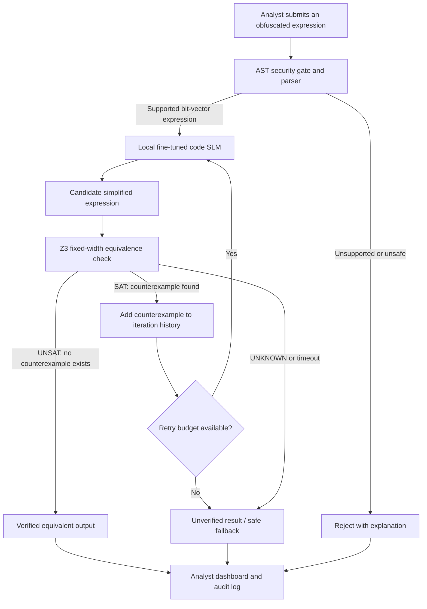

PALIMPSEST
Autonomous Neurosymbolic De-obfuscation
The AI proposes. The mathematics proves.

Codename: VEX-MORPH · DEXATHON 2026 · AI/ML + Cybersecurity · Software
  
Turn difficult-to-read, mathematically obfuscated expressions into simpler expressions—with a machine-checkable equivalence result, not an AI guess.

Overview · Architecture · Workflow · Demo · AI/ML · Evaluation · Project Setup · References
Project status: This README describes the proposed architecture and hackathon MVP from our pitch and system blueprint. Features, benchmarks and deployment claims are design goals unless explicitly accompanied by measured results. A verified rewrite is guaranteed equivalent only within the specified bit-vector semantics and when Z3 returns UNSAT.

The problem
Malicious software and protected programs can disguise simple operations behind complex combinations of arithmetic and bitwise operators. This technique is called Mixed Boolean-Arithmetic (MBA) obfuscation. For a security analyst, a routine that should be easy to understand can become a large, confusing expression.

Traditional reverse-engineering tools are essential, but difficult obfuscation may still require manual investigation. A general-purpose AI can suggest simpler code, yet it can silently change the program's behavior. In sensitive environments, uploading unknown binaries or proprietary code to an external AI service may also be unacceptable.

Our core problem statement
How can we accelerate the simplification of obfuscated code without trusting an AI-generated rewrite until its behavior has been formally verified, while keeping the analysis local?

A tiny example
These expressions are equivalent for fixed-width bit-vector addition:
Obfuscated: (x ^ y) + 2 * (x & y)
Simplified: x + y
Here ^ means bitwise XOR and & means bitwise AND. The first expression hides an ordinary addition behind an XOR-and-carry identity. Real inputs may contain many more layers of substitutions.

PALIMPSEST does not stop at “this looks simpler.” It checks whether the candidate is actually equivalent.
Our solution
PALIMPSEST combines a specialized local code language model that proposes simplifications with the Microsoft Z3 SMT solver that proves or rejects those proposals; rejected candidates can be revised using concrete counterexamples.
Why this is different from an AI chatbot
Generic AI code explanation	PALIMPSEST approach
Suggests a plausible simplified expression	Proposes a candidate and formally checks it
An incorrect result can sound convincing	Failed candidates return a concrete counterexample
Often relies on a remote model API	Designed for local inference and local verification
Provides a textual answer	Produces a result, verification status, and analysis trace

The new capability is the closed-loop combination, not the invention of LLMs, symbolic solvers, or de-obfuscation individually.
System architecture

The five core components
Layer	Planned technology	Responsibility
1 · Input & safety gate	Python AST + strict operator whitelist	Accept only supported arithmetic/bitwise expressions; reject executable calls and unsupported syntax
2 · Neural proposer	Qwen2.5-Coder-3B-Instruct; Unsloth + QLoRA	Generate a shorter candidate expression from an obfuscated input
3 · Symbolic judge	Microsoft Z3 / fixed-width bit-vectors	Check whether the original and candidate ever produce different outputs
4 · Feedback controller	LangGraph (planned)	Route SAT counterexamples back to the model and enforce retry/timeout budgets
5 · Analyst interface & log	Python UI (to be selected) + SQLite	Display inputs, outputs, verification status, timings and iteration traces

Separation of responsibilities: The model is allowed to suggest. Only the formal checker can mark a candidate Verified. A timeout or UNKNOWN is not a proof of equivalence.
User workflow
1. Paste a supported obfuscated expression into the local PALIMPSEST interface.
2. Validate it safely. The system parses the expression and extracts operators, symbols, bit width and complexity measures. It never executes the submitted expression as arbitrary Python code.
3. Ask the local AI for a simpler rewrite. The model proposes an expression that may be easier to inspect.
4. Check the rewrite using Z3. The solver asks whether any allowed input makes the original and proposed results different.
5. Learn from an error. If Z3 finds such an input, the system returns the counterexample to the proposer and attempts a correction, up to a bounded retry count.
6. Review the result. The analyst receives the candidate, its verified/unverified status, a complexity comparison, the solver trace, and any limitations.
Three possible outcomes
Status	Meaning	Safe behavior
✅ Verified equivalent	Z3 returned UNSAT for the difference formula	Show simplified expression as equivalent under the modeled semantics
❌ Rejected candidate	Z3 returned SAT with an input where results differ	Show the counterexample; do not treat the candidate as valid
⚠️ Unverified / unknown	Parse failed, solver timed out, or retry budget ended	Keep the original expression and explain why no proof was obtained

Worked example
Original expression (illustrative 64-bit bit-vector semantics):
((x ^ y) + 2 * (x & y)) + (((x | y) - (x ^ y)) - (x & y))
The rightmost part simplifies to zero, so the entire expression is equivalent to x + y.

Attempt 1 — AI proposes:
x ^ y
This is wrong. For x = 1 and y = 1, the original produces 2, but 1 ^ 1 produces 0. Z3 can return a counterexample demonstrating the mismatch.

Attempt 2 — guided by the counterexample:
x + y
The solver checks:
(original_expression != (x + y))
If Z3 returns UNSAT, no differing assignment exists in the defined bit-vector model. The system can report Verified equivalent and display the simpler expression.
This is a conceptual demo trace, not an independently measured model run. The exact counterexample, speed and number of attempts in a live execution may differ.

How mathematical verification works
For two expressions, original(x) and candidate(x), PALIMPSEST constructs:
\[
\mathrm{original}(\mathbf{x}) \ne \mathrm{candidate}(\mathbf{x})
\]
Z3 tries to satisfy that inequality using fixed-width bit-vector semantics.
- SAT → at least one counterexample exists; the candidate is not equivalent.
- UNSAT → no counterexample exists in the modeled input domain; the candidate is equivalent under those semantics.
- UNKNOWN → the solver has not established equivalence.
The original blueprint targets 64-bit expressions. With two independent 64-bit inputs, the search space contains \(2^{128}\) assignments; symbolic reasoning avoids brute-force enumeration. Verification coverage is limited to the correctly parsed, modeled expression—not an automatic proof that an entire executable is malware-free or safe.
AI/ML approach
PALIMPSEST proposes task-specific adaptation of a small decoder-only code model rather than training a large model from scratch.
7.1 Synthetic training data: “Trapdoor Inverse”
Generating obfuscation is easier than reversing it. Start with a simple expression and apply valid transformations:
Clean expression --> apply verified MBA identities --> obfuscated expression
       target                                         training input
Invert each generated pair to teach the model obfuscated → simple. Use Z3 to filter out invalid pairs before training.

Planned examples include addition identities, XOR/AND/OR rewrites, nested substitutions and expressions containing redundant zero-valued terms.
7.2 Fine-tune and test
- Model: Qwen2.5-Coder-3B-Instruct (proposed base model).
- Adaptation: QLoRA through Unsloth for supervised fine-tuning.
- Optional advanced stage: preference training for shorter, verified rewrites; this is not required for the MVP.
- Evaluation: use a held-out dataset with different expression shapes and obfuscation depths. Prevent near-duplicate training/test leakage.
- Baselines: compare a non-fine-tuned model, deterministic simplification, and the fine-tuned model using the same test set.
Important: Training on a GPU service such as Kaggle would mean training is not entirely local. The goal of offline inference should be evaluated separately from the training location.
Scope — what we can demonstrate credibly
Hackathon MVP (priority)
- [ ] Strict AST parser for a limited, documented bitwise/arithmetic grammar.
- [ ] Synthetic expression-pair generator with Z3 dataset checks.
- [ ] Local or controlled-inference model proposing simple rewrites.
- [ ] Z3 equivalence checker with clear SAT / UNSAT / UNKNOWN results.
- [ ] Bounded counterexample-feedback loop.
- [ ] Simple interface with side-by-side code, verification and trace.
- [ ] Automated tests and a reproducible benchmark table.
Future extensions (not assumed in v1)
- Full binary lifting or decompilation integration.
- Opaque-predicate and control-flow flattening handling.
- Larger functions and more complex program semantics.
- Stronger sandbox isolation and packaged offline deployment.
- IDE/decompiler plugins and enterprise audit workflows.
The initial MVP focuses on MBA expression de-obfuscation, not unrestricted de-obfuscation of arbitrary malware binaries.
Evaluation and hackathon demo
We propose these measurable metrics. Populate with actual experiment results before final submission.
Metric	How it is measured	Current result
Verified rewrite rate	Z3-proven simplified outputs ÷ total eligible test inputs	To be measured
AST reduction	(original AST nodes − final AST nodes) / original AST nodes × 100 for verified outputs	To be measured
Median end-to-end latency	Parsing + model inference + all solver calls	To be measured
Invalid proposal rate	Candidate proposals rejected by Z3 ÷ total proposals	To be measured
Recovery rate	Initially rejected cases eventually verified within retry budget	To be measured
Local inference footprint	Peak RAM/VRAM and runtime on named hardware	To be measured

The pitch deck mentions 92% AST reduction, <150 ms proposal latency and <2.5 GB VRAM. These should be displayed as design aspirations unless actual benchmark logs substantiate them. No system should claim universal recovery from all obfuscation or automatic correctness when the solver times out.
Demo script (approximately three minutes)
1. Problem (20 s): Show an unreadable MBA expression and explain why guessing its meaning is risky.
2. AI proposal (35 s): Run the local model and display its simplified suggestion.
3. Trust test (45 s): Deliberately show a wrong candidate being rejected with a counterexample.
4. Self-correction (45 s): Feed back the counterexample and verify a corrected candidate.
5. Evidence (35 s): Display the final expression, Z3 outcome, AST node comparison and recorded run trace.
The moment that matters: the AI is wrong, the mathematics catches it, and the system refuses to label an unproven answer as correct.
Privacy & security design
- Local-first inference: The intended deployment keeps model inference and verification on controlled hardware, rather than automatically sending code to third-party AI APIs.
- Allowlisted expression grammar: The parser must reject executable code, imports, function calls and unsupported syntax. Never call Python eval on untrusted input.
- Resource limits: Apply bounded retries and solver timeouts; report UNKNOWN rather than manufacture a proof.
- Human control: Outputs are analyst-reviewed and are not automatically executed against external systems.
- Data minimization: Store only the logs required for testing or authorized analysis.
- Sandboxing: Process isolation and offline/container restrictions require independent verification; MCP alone is not a security sandbox.
PALIMPSEST is intended for authorized defensive security analysis and research.
Proposed repository structure
The following is a suggested directory layout, not a claim that these files already exist:
palimpsest/
├── README.md
├── requirements.txt
├── src/
│   ├── parser/              # AST validation and bit-vector lifting
│   ├── data/                # Synthetic obfuscation-pair generator
│   ├── model/               # Local SLM adapter and inference
│   ├── verifier/            # Z3 equivalence checking
│   ├── agent/               # Bounded CEGIS loop
│   └── ui/                  # Analyst dashboard
├── tests/                   # Unit and end-to-end tests
├── benchmarks/              # Held-out cases and measured results
├── docs/                    # Architecture, limitations, demo
└── assets/                  # Screenshots and GIFs
Setup & running locally
Add tested installation and execution commands here once the repository code is available. Do not copy placeholder commands into a judging demo without verifying the correct dependencies, model location and operating system. Record the tested Python version, package versions, CPU/GPU, model artifact and license.
Feasibility, risks and mitigations
Challenge	Mitigation
Model proposes incorrect algebra	Z3 rejects counterexamples; only UNSAT permits a verified label
SMT verification becomes slow	Timeouts, bounded retries, narrower expression scope
Incorrect parsing or bit width	Restrict syntax and use consistent, explicit bit-vector semantics
Local model requires too much memory	Quantize and benchmark against actual hardware; reduce model size if necessary
Synthetic data is too repetitive	Vary transformations, hold out expression families, track generalization
Broad malware-analysis claims outgrow MVP	Demonstrate supported MBA expressions first; clearly label future work

Who benefits, and why it matters
Primary users: malware researchers, reverse engineers, incident-response teams and students learning formal software analysis.

Potential value: less time spent inspecting certain classes of obfuscated expressions, better auditability of proposed rewrites, and improved privacy where local processing is required.

Longer-term opportunity: a specialist assistant integrated into reverse-engineering workflows. Enterprise adoption would require validation on real workloads, legal review of input data handling, and comparisons with established tools—not merely a successful synthetic demo.
Research and technology references
- Microsoft Z3 SMT Solver — formal verification and fixed-width bit-vector reasoning.
- Qwen2.5-Coder-3B-Instruct — proposed code-focused language model.
- Unsloth documentation — parameter-efficient fine-tuning workflow.
- LangGraph documentation — stateful orchestration and conditional loops.
- QLoRA paper — memory-efficient fine-tuning.
- Counterexample-Guided Inductive Synthesis (CEGIS) — conceptual foundation for iterated proposal and verification.
Project documents: PALIMPSEST Pitch Deck and PALIMPSEST Full Blueprint (team-authored design references).
Team and hackathon
Project: PALIMPSEST (VEX-MORPH)
Event: DEXATHON 2026 · Sathyabama Institute of Science and Technology, Chennai
Category: Software
Track: AI & Machine Learning / Cybersecurity (use the exact registered track in your final submission)
Team name: [ADD REGISTERED TEAM NAME]
Team ID: [ADD TEAM ID]
Repository: [ADD REPOSITORY LINK]

AI can suggest a shortcut. PALIMPSEST makes it earn your trust.
Propose → Prove → Correct → Verify

